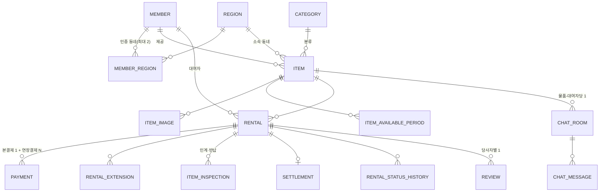

# 데이터 모델

- 이름·제약·인덱스 규칙은 `docs/conventions.md` §4. 요약: 테이블 snake_case 복수형, 컬럼 snake_case(JPA 필드 camelCase 자동 변환), MySQL 예약어 금지. 모든 테이블에 `created_at`, `updated_at` (BaseTimeEntity).
- 금액 `INT`(원). 날짜 `DATE`, 시각 `DATETIME(6)`.
- 상태 컬럼은 `VARCHAR` + 영문 Enum 코드 (`state-machines.md`).
- 순위 표기: [1] 1순위 단계에서 필요, [2] 2순위, [3] 3순위. 아직 필요 없는 테이블은 만들지 않는다.

## 핵심 관계

> 원본 ERD는 RENTAL–PAYMENT를 1:1로 그렸지만 대여 연장(REQ-038)이 추가 결제를 만들므로 1:N으로 정리했다. `open-issues.md` #1 참고.

## 회원 [1]

**members**
| 컬럼 | 타입 | 제약 |
| --- | --- | --- |
| id | BIGINT | PK |
| email | VARCHAR(100) | UK |
| password | VARCHAR(100) | BCrypt, 소셜 전용이면 NULL |
| nickname | VARCHAR(10) | UK |
| profile_image_url | VARCHAR(500) | |
| provider | VARCHAR | `LOCAL`/`KAKAO` |
| trust_score | DECIMAL(4,1) | 기본 50.0 (0.5 단위 가산이 있어 정수 불가) [3] |
| role | VARCHAR | `USER`/`ADMIN` |
| status | VARCHAR | `ACTIVE`/`SUSPENDED`/`WITHDRAWN` |

**regions** — 행정동 마스터(초기 데이터 적재)
| id PK | code(행정동 코드, UK) | name | sido | sigungu | center_lat DOUBLE | center_lng DOUBLE |

**member_regions**
| id PK | member_id FK | region_id FK | is_primary BOOLEAN | verified_at DATETIME NULL | region_range VARCHAR(`NEAR/NORMAL/FAR`) |
- UK(member_id, region_id). 회원당 최대 2행, is_primary=true는 1행.
- 인증 유효 = `verified_at + 30일 > now`.

**terms_agreements** [2] — member_id, terms_type, terms_version, agreed_at

## 물품 [1]

**categories**
| id PK | code UK | name | parent_id NULL(미사용) | sort_order | is_active |

**items**
| 컬럼 | 비고 |
| --- | --- |
| id PK | |
| owner_id FK→members | |
| region_id FK→regions | 등록 시 대표 동네 |
| category_id FK | |
| name VARCHAR(50), description TEXT(≤2000) | |
| item_condition | `ItemCondition` (`condition`은 MySQL 예약어라 피함) |
| price_per_day INT, deposit INT, item_price INT | item_price는 비공개 |
| address VARCHAR, latitude DOUBLE, longitude DOUBLE | 거래 장소 |
| status | `AVAILABLE/HIDDEN/DELETED` |
| view_count, wish_count, chat_count INT | 비정규화 카운터 |
| bumped_at DATETIME | 등록 시 created_at과 동일하게 세팅 → 피드 정렬 키 |

인덱스(초기안, 실험으로 개선 — 도전 과제 ④):
- `(status, bumped_at DESC, id DESC)` 피드 커서
- `(latitude, longitude)` 또는 Geohash 컬럼 + 인덱스 / MySQL SPATIAL(POINT SRID 4326)
- `(owner_id, status)`, `(category_id, status)`
- 키워드 검색: 초기 LIKE → 필요 시 FULLTEXT(ngram)

**item_images** — id, item_id, url, thumbnail_url, sort_order
**item_available_periods** — id, item_id, start_date, end_date (같은 물품 내 구간 겹침 금지 — 애플리케이션 검증)

## 대여 [1]

**rentals**
| 컬럼 | 비고 |
| --- | --- |
| id PK | |
| item_id FK, renter_id FK | owner는 item에서 조회 (조회 편의를 위해 owner_id 비정규화 허용) |
| start_date, end_date DATE | 연장 시 end_date 갱신 |
| rental_fee INT | 최초 대여료 (연장료는 rental_extensions) |
| deposit INT | 예약 시점 스냅샷 (물품 가격 변경과 무관) |
| price_per_day INT | 예약 시점 스냅샷 |
| status | `RentalStatus` |
| payment_expires_at DATETIME NULL | PENDING_PAYMENT 만료 시각 |
| returned_at DATETIME NULL | 반납 요청 시각 (3일 자동 확인 기준) |
| cancel_reason, canceled_by | |
| extension_count INT | 기본 0 |
| version BIGINT | 낙관적 락 실험용 |
- 인덱스 `(item_id, status, start_date, end_date)`, `(renter_id, status)`, `(status, end_date)`(연체 배치), `(status, returned_at)`(자동 확인 배치).
- 기간 겹침은 MySQL 유니크 제약으로 막을 수 없다 → 락 + 검사 쿼리 (도전 과제 ①).

**rental_status_histories** — id, rental_id, from_status, to_status, changed_by NULL, reason, changed_at
**rental_extensions** [2] — id, rental_id, prev_end_date, new_end_date, additional_fee, payment_id

**item_inspections**
| id | rental_id | phase(`HANDOVER/RETURN`) | image_urls JSON | checklist JSON(RETURN만) | note | result(`NORMAL/ABNORMAL`, 제공자 판정) | result_note | result_image_urls JSON | ai_result JSON [2] | written_by | created_at |
- UK(rental_id, phase). 제출 후 수정 불가(업데이트 API 없음, 판정 필드만 1회 기록).

## 결제 [2]

**payments**
| 컬럼 | 비고 |
| --- | --- |
| id, rental_id FK | |
| type | `RENTAL`(대여료+보증금) / `EXTENSION`(연장료) |
| order_id UK, payment_key | 토스 |
| amount INT, rental_fee_amount INT, deposit_amount INT | 분리 저장 |
| status | `PaymentStatus` |
| deposit_status | `DepositStatus` (type=RENTAL만) |
| refunded_amount INT | 누적 취소 금액 |
| damage_grade, deduction_amount, deduction_reason | REQ-049 |
| idempotency_key UK | |

**payment_transactions** (구현 제안) — 승인·취소 시도 이력: payment_id, action(APPROVE/CANCEL), amount, idempotency_key, result(SUCCESS/FAIL), pg_response JSON, created_at. 재시도·조정 배치의 근거.

**deduction_proposals** (구현 제안) — rental_id, grade, amount, reason, evidence_urls JSON, status(PROPOSED/ACCEPTED/REJECTED), created_at. 재제안 이력 보관.

**damage_policies** — id, category_id, grade, deduction_type, fixed_amount, cap_rate, recommended_deposit_min_rate, recommended_deposit_max_rate (초기값: `policies.md` §4)

**settlements** — id, rental_id UK, owner_id, rental_fee, fee_amount, deduction_amount, payout_amount, scheduled_date, status

## 관심·조회 [2]

**wishes** — id, member_id, item_id, created_at, UK(member_id, item_id)
**item_view_logs** — id, member_id, item_id, viewed_at, UK(member_id, item_id) (재조회 시 viewed_at 갱신, 회원당 20건 유지)

## 채팅 [2]

**chat_rooms** — id, item_id, renter_id, owner_id, last_message_at, last_message_preview, UK(item_id, renter_id)
**chat_messages** — id, room_id, sender_id NULL(SYSTEM), type, content, sent_at, read_at
- 인덱스 `(room_id, id DESC)` 커서 조회
- 안 읽은 수: 참여자별 `last_read_message_id`를 `chat_room_members`(구현 제안)에 두면 계산이 단순해진다.

## 알림 [2]

**notifications** — id, member_id, type, content, target_type, target_id, event_id UK(중복 방지), is_read, created_at
**keywords** [3] — id, member_id, word, region_id
**notification_settings** [3] — member_id, type, enabled

## 신뢰 [2]/[3]

**reviews** — id, rental_id, writer_id, target_id, satisfaction, content, created_at, UK(rental_id, writer_id)
**review_compliments** — review_id, type
**reports** [3] — id, reporter_id, target_type(ITEM/MEMBER/CHAT), target_id, reason, status
**blocks** [3] — blocker_id, blocked_id, UK
**trust_score_events** (구현 제안) [3] — member_id, reason, delta, source_id — 점수 재계산·감사용

## 관리·기타 [3]

**category_suggestions** — id, item_id, suggested_name, status, reviewed_by
**inquiries** — id, member_id, rental_id NULL, type, content, status
**appointments** (REQ-051) — id, room_id, rental_id NULL, type(HANDOVER/RETURN), scheduled_at, place, latitude, longitude

## Redis 키 규약

| 키 | 용도 | TTL |
| --- | --- | --- |
| `rt:{memberId}` | Refresh Token | 14일 |
| `lock:item:{itemId}` | 예약·연장·기간 수정 분산 락 | 임대 5초 |
| `view:{itemId}:{memberId or ip}` | 조회수 중복 방지 | 24시간 |
| `viewcount:{itemId}` | 조회수 증분(주기적 DB 반영) | — |
| `search:popular` | 인기 검색어 Sorted Set | — |
| `search:recent:{memberId}` | 최근 검색어 List | — |
| `recommend:{memberId}` | 추천 결과 | 1시간 |
| `pwreset:{token}` | 비밀번호 재설정 | 30분 |
| `pwreset:rate:{email}` | 요청 제한 | 5분 |
