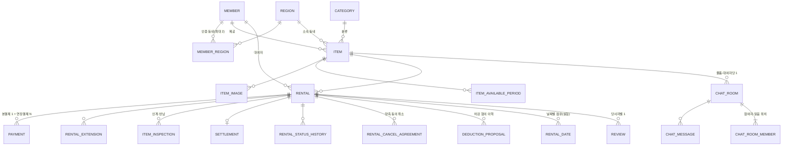

# 데이터 모델

## 마이그레이션 번호

Flyway 번호의 단일 기준이다. 마이그레이션을 만드는 브랜치는 **첫 커밋에서 이 표에 행을 넣고 바로 push**해 번호를 선점하고, PR을 만들 때 상태를 "머지"로 바꾼다(develop에 들어간 행은 곧 머지된 것이다). 번호를 고를 때는 develop의 이 표와 원격 작업 브랜치의 이 표를 둘 다 보고 가장 큰 번호 + 1을 쓴다(`docs/git-workflow.md` §4).

| 번호 | 파일 | 브랜치 | 상태 |
| --- | --- | --- | --- |
| V1 | `V1__create_member_tables.sql` | `feat/member-item-entity` (#8) | 머지 |
| V2 | `V2__create_item_tables.sql` | `feat/member-item-entity` (#8) | 머지 |
| V3 | `V3__insert_categories.sql` | `feat/member-item-entity` (#8) | 머지 |
| V4 | `V4__create_rental_tables.sql` | `feat/rental-entity` (#9) | 머지 |
| V5 | `V5__create_rental_cancel_agreements.sql` | `feat/rental-cancel` (#12) | 머지 |
| V6 | `V6__create_item_inspections.sql` | `feat/rental-return` | 머지 |
| V7 | `V7__create_payment_tables.sql` | `feat/payment-core` | 작업 중 |

## 규칙

- 이름·제약·인덱스 규칙은 `docs/conventions.md` §4. 요약: 테이블 snake_case 복수형, 컬럼 snake_case(JPA 필드 camelCase 자동 변환), MySQL 예약어 금지. 모든 테이블에 `created_at`, `updated_at` (BaseTimeEntity).
- 금액 `INT`(원). 날짜 `DATE`, 시각 `DATETIME(6)`.
- 상태 컬럼은 `VARCHAR` + 영문 Enum 코드 (`state-machines.md`).
- 순위 표기: [1] 1순위 단계에서 필요, [2] 2순위, [3] 3순위. 아직 필요 없는 테이블은 만들지 않는다.

## 핵심 관계

> 원본 ERD는 RENTAL–PAYMENT를 1:1로 그렸지만 대여 연장(REQ-038)이 추가 결제를 만들므로 1:N으로 정리했다. `open-issues.md` #1 참고.

## 회원 [1]

**members**
| 컬럼 | 타입 | 제약 |
| --- | --- | --- |
| id | BIGINT | PK |
| email | VARCHAR(100) | UK |
| password | VARCHAR(100) | BCrypt, 소셜 전용이면 NULL |
| nickname | VARCHAR(10) | UK |
| profile_image_url | VARCHAR(500) | |
| provider | VARCHAR(30) | `LOCAL`/`KAKAO` |
| trust_score | DECIMAL(4,1) | 기본 50.0 (0.5 단위 가산이 있어 정수 불가). 갱신은 [3] |
| role | VARCHAR(30) | `USER`/`ADMIN` |
| status | VARCHAR(30) | `ACTIVE`/`SUSPENDED`/`WITHDRAWN` |

**regions** — 행정동 마스터(초기 데이터 적재)
| id PK | code VARCHAR(10) UK(행정동 코드 10자리) | name VARCHAR(30) | sido VARCHAR(20) | sigungu VARCHAR(30) | center_lat DOUBLE | center_lng DOUBLE |

**member_regions**
| id PK | member_id FK | region_id FK | is_primary BOOLEAN | verified_at DATETIME(6) NULL | region_range VARCHAR(30)(`NEAR/NORMAL/FAR`, 기본 NORMAL) |
- UK(member_id, region_id). 회원당 최대 2행, is_primary=true는 1행(애플리케이션 검증).
- 인증 유효 = `verified_at + region.verify-valid-days > now` (`policies.md`).

**terms_agreements** [2] — member_id, terms_type, terms_version, agreed_at

## 물품 [1]

**categories**
| id PK | code VARCHAR(30) UK | name VARCHAR(30) | parent_id NULL(미사용, FK→categories) | sort_order INT | is_active BOOLEAN(기본 true) |
- 초기 데이터 `V3__insert_categories.sql`(`policies.md` §3).

**items**
| 컬럼 | 비고 |
| --- | --- |
| id PK | |
| owner_id FK→members | |
| region_id FK→regions | 등록 시 대표 동네 |
| category_id FK | |
| name VARCHAR(50), description TEXT(≤2000) | |
| item_condition VARCHAR(30) | `ItemCondition` (`condition`은 MySQL 예약어라 피함) |
| price_per_day INT, deposit INT, item_price INT | item_price는 비공개 |
| address VARCHAR(200), latitude DOUBLE, longitude DOUBLE | 거래 장소 |
| status VARCHAR(30) | `AVAILABLE/HIDDEN/DELETED` |
| view_count, wish_count, chat_count INT | 비정규화 카운터, 기본 0 |
| bumped_at DATETIME(6) | 등록 시 created_at과 동일하게 세팅 → 피드 정렬 키 |

인덱스(초기안, 실험으로 개선 — 도전 과제 ④):
- `idx_items_status_bumped_at_id (status, bumped_at DESC, id DESC)` 피드 커서 — 생성됨
- `idx_items_owner_id_status (owner_id, status)`, `idx_items_category_id_status (category_id, status)` — 생성됨
- `(latitude, longitude)` 또는 Geohash 컬럼 + 인덱스 / MySQL SPATIAL(POINT SRID 4326) — 피드 실험에서 결정, 아직 없음
- 키워드 검색: 초기 LIKE → 필요 시 FULLTEXT(ngram) — 아직 없음

**item_images** — id, item_id, url VARCHAR(500), thumbnail_url VARCHAR(500), sort_order INT(0이 대표)
**item_available_periods** — id, item_id, start_date, end_date (같은 물품 내 구간 겹침 금지 — 애플리케이션 검증). 인덱스 `idx_item_available_periods_item_id_start_date (item_id, start_date)`

## 대여 [1]

**rentals**
| 컬럼 | 비고 |
| --- | --- |
| id PK | |
| item_id FK→items, renter_id FK→members | |
| owner_id FK→members | items.owner_id 비정규화(원본 items.owner_id, 생성 시 1회 복사 — 물품 소유자는 바뀌지 않음). 빌려준 내역·제공자 권한 확인을 조인 없이 |
| start_date, end_date DATE | 연장 시 end_date 갱신 |
| rental_fee INT | 최초 대여료 (연장료는 rental_extensions) |
| deposit INT | 예약 시점 스냅샷 (물품 가격 변경과 무관) |
| price_per_day INT | 예약 시점 스냅샷 |
| status VARCHAR(30) | `RentalStatus` |
| payment_expires_at DATETIME(6) NULL | PENDING_PAYMENT 만료 시각 |
| handed_over_at DATETIME(6) NULL | 인계 확인 시각 |
| returned_at DATETIME(6) NULL | 반납 요청(또는 미반납 신고) 시각 — 3일 자동 확인·연체료 기준 |
| completed_at DATETIME(6) NULL | 거래 완료 시각 — 후기 7일 기한·정산 예정일 기준 |
| canceled_at DATETIME(6) NULL | 취소 시각 |
| cancel_type VARCHAR(30), cancel_reason VARCHAR(30), cancel_reason_text VARCHAR(200), canceled_by FK→members NULL | `CancelType`, `CancelReason`. 텍스트 200자는 `cancel.reason-text-max`. 시스템 취소면 canceled_by NULL |
| cancel_fee INT | 기본 0. 취소 수수료 (`policies.md` §2) |
| overdue_fee INT | 기본 0. 반납 시점에 확정 |
| extension_count INT | 기본 0 |
| version BIGINT | 기본 0. `@Version`(낙관적 락) — 기본 경로에서도 켜 둔다 |
- 인덱스 `(item_id, status, start_date, end_date)`(겹침 검사), `(renter_id, status)`(빌린 내역), `(owner_id, status)`(빌려준 내역), `(status, end_date)`(연체·반납 리마인더 배치), `(status, start_date)`(인계 없음 자동 취소), `(status, returned_at)`(자동 확인 배치) — 생성됨(`V4`). 이름은 `idx_rentals_{컬럼들}`.
- FK 이름: members를 세 번 참조하므로 `fk_rentals_members_{owner|renter|canceled_by}`(`conventions.md` §4).
- 기간 겹침은 `rentals`의 시작·종료일 컬럼만으로는 유니크 제약을 걸 수 없다. 대신 아래 `rental_dates`(날짜별 점유)에 유니크 제약을 걸면 DB가 막을 수 있다. 기본 경로는 분산 락 + 검사 쿼리이고, `rental_dates`는 도전 과제 ① 비교 실험의 대상이다.

**rental_dates** [1, 실험용] — item_id, rented_date DATE, rental_id FK, **UK(item_id, rented_date)**. 예약·연장 확정 시 날짜마다 1행 INSERT, 취소·결제 만료·연장 취소 시 삭제. 실험 결과로 채택이 정해지기 전에는 기본 경로에서 쓰지 않는다.

**rental_status_histories** — id, rental_id FK, from_status VARCHAR(30) NULL(생성 이력), to_status VARCHAR(30), changed_by FK→members NULL(시스템), reason VARCHAR(255) NULL(배치명 또는 사유), changed_at DATETIME(6). 인덱스 `idx_rental_status_histories_rental_id_changed_at (rental_id, changed_at)` — 생성됨(`V4`)
**rental_cancel_agreements** [1] — id, rental_id FK, requested_by FK→members, reason VARCHAR(30)(`CancelReason`), reason_text VARCHAR(200) NULL, status VARCHAR(30)(`CancelAgreementStatus`), expires_at DATETIME(6), responded_at DATETIME(6) NULL(만료면 NULL), created_at, updated_at. 인덱스 `(rental_id, status)`, `(status, expires_at)`(만료 배치) — 생성됨(`V5`). 한 대여에 진행 중(REQUESTED이고 expires_at > now)인 요청은 1건만(대여 행 락 안에서 애플리케이션 검증). `@Version` 없음(만료는 벌크 UPDATE).
**rental_extensions** [2] — id, rental_id, prev_end_date, new_end_date, additional_fee, status(`ExtensionStatus`), expires_at(결제 대기 만료), payment_id NULL. 인덱스 `(status, expires_at)`. PENDING_PAYMENT이고 만료 전인 행의 기간은 예약 겹침 검사 대상.

**item_inspections**
| id | rental_id | phase(`HANDOVER/RETURN`) | image_urls JSON | checklist JSON(RETURN만) | note | lost_reported BOOLEAN(미반납 신고, 사진 없음) | result(`NORMAL/ABNORMAL`, 제공자 판정) | result_note | result_image_urls JSON | ai_result JSON [2] (040에서 추가) | written_by | created_at |
- V6에서 생성(ai_result 제외). UK `uk_item_inspections_rental_id_phase`(rental_id, phase). 제출 후 수정 불가(업데이트 API 없음, 판정 필드만 1회 기록). 사진은 저장소 URL 배열(item_images와 같음). note는 인계 메모·반납 메모 300자, result_note 500자.

## 결제 [2]

**payments**
| 컬럼 | 비고 |
| --- | --- |
| id, rental_id FK | |
| type | `RENTAL`(대여료+보증금) / `EXTENSION`(연장료) |
| order_id UK, payment_key | 토스 |
| amount INT, rental_fee_amount INT, deposit_amount INT | 분리 저장. 결제 금액 0원이면 레코드를 만들지 않음 |
| status | `PaymentStatus` |
| deposit_status | `DepositStatus` (type=RENTAL만) |
| held_at DATETIME(6) NULL | 보증금 보류 시작 — 7일 관리자 확정 기준 |
| refunded_amount INT | 누적 취소 금액 |
| refund_pending_amount INT NULL | 아직 끝나지 않은 환불액. NULL이 아니면 환불이 남아 있다(재시도 배치 대상). 보증금 0원이라 depositStatus가 NONE인 결제의 취소 환불 실패, TX1 직후 서버 중단도 이 값으로 찾는다 |
| last_refund_attempt_at DATETIME(6) NULL | 마지막 PG 취소 시도 시각(시도마다 기록). 재시도 간격의 기준 |
| refund_retry_count INT, needs_admin_check BOOLEAN | 환불 재시도 횟수, 5회 초과 시 true |
| damage_grade, deduction_amount, deduction_reason | **확정된 차감 결과만** (협의 이력은 deduction_proposals). 손상 발생률 집계용. `held_at`과 함께 REQ-049 마이그레이션에서 추가 |
| idempotency_key UK | |

**payment_transactions** — 승인·취소 시도 이력: payment_id, action(APPROVE/CANCEL), amount, idempotency_key, result(PENDING/SUCCESS/FAIL), pg_response JSON, created_at, updated_at. 재시도·조정 배치의 근거. PENDING은 PG 호출 전 기록(TX1)이고, 타임아웃으로 결과를 모르면 PENDING으로 남아 조정 배치가 처리한다.

**deduction_proposals** — id, rental_id, proposed_by, grade, amount, reason, evidence_urls JSON, status(`DeductionProposalStatus`), responded_at, created_at. 인덱스 `(status, created_at)`(72시간 자동 수락 배치). **협의 이력 전용**이며, 확정되면 그 값이 payments에 한 번 복사된다.

**damage_policies** [1] — (1순위로 당김, 권장 보증금 REQ-006이 쓴다. 테이블·시드는 `feat/item-crud`, open-issues #23) id, category_id, grade, deduction_type, fixed_amount, cap_rate, recommended_deposit_min_rate, recommended_deposit_max_rate (초기값: `policies.md` §4)

**settlements** — id, rental_id UK, owner_id, source(`COMPLETED`/`CANCEL_FEE`), gross_amount(대여료+연장료+연체료 또는 취소 수수료), fee_amount, deduction_amount, payout_amount, scheduled_date, status

## 관심·조회 [2]

**wishes** — id, member_id, item_id, created_at, UK(member_id, item_id)
**item_view_logs** — id, member_id, item_id, viewed_at, UK(member_id, item_id) (재조회 시 viewed_at 갱신, 회원당 20건 유지)

## 채팅 [2]

**chat_rooms** — id, item_id, renter_id, owner_id, last_message_at, last_message_preview, UK(item_id, renter_id)
**chat_room_members** — room_id, member_id, last_read_message_id, PK(room_id, member_id). **읽음 처리의 유일한 기준**
**chat_messages** — id, room_id, sender_id NULL(SYSTEM), type, content, sent_at
- 인덱스 `(room_id, id DESC)` 커서 조회
- 안 읽은 수 = `count(id > last_read_message_id AND sender_id != me)`. 메시지별 "읽음" 표시는 상대의 last_read_message_id와 비교해 계산한다(메시지마다 read_at을 따로 두지 않음).

## 알림 [2]

**notifications** — id, member_id, type, content, target_type, target_id, event_id UK(중복 방지), is_read, created_at
**keywords** [3] — id, member_id, word, region_id
**notification_settings** [3] — member_id, type, enabled

## 신뢰 [2]/[3]

**reviews** — id, rental_id, writer_id, target_id, satisfaction, content, created_at, UK(rental_id, writer_id)
**review_compliments** — review_id, type
**reports** [3] — id, reporter_id, target_type(ITEM/MEMBER/CHAT), target_id, reason, status
**blocks** [3] — blocker_id, blocked_id, UK
**trust_score_events** (구현 제안) [3] — member_id, reason, delta, source_id — 점수 재계산·감사용

## 관리·기타 [3]

**category_suggestions** — id, item_id, suggested_name, status, reviewed_by
**inquiries** — id, member_id, rental_id NULL, type, content, status
**appointments** (REQ-051) — id, room_id, rental_id NULL, type(HANDOVER/RETURN), scheduled_at, place, latitude, longitude

## Redis 키 규약

| 키 | 용도 | TTL |
| --- | --- | --- |
| `rt:{memberId}:{familyId}` | 기기(로그인)별 현재 유효한 Refresh Token jti | 14일 |
| `rt-families:{memberId}` | 회원의 family 목록 Set (전체 기기 로그아웃용) | 14일 |
| `lock:item:{itemId}` | 예약·연장·기간 수정·물품 삭제 분산 락 | 임대 시간 미지정(watchdog 자동 연장) |
| `view:{itemId}:{memberId or ip}` | 조회수 중복 방지 | 24시간 |
| `viewcount:{itemId}` | 조회수 증분(주기적 DB 반영) | — |
| `search:popular` | 인기 검색어 Sorted Set | — |
| `search:recent:{memberId}` | 최근 검색어 List | — |
| `recommend:{memberId}` | 추천 결과 | 1시간 |
| `pwreset:{token}` | 비밀번호 재설정 | 30분 |
| `pwreset:rate:{email}` | 요청 제한 | 5분 |
| `ai:usage:{yyyyMM}` | AI 호출 월 사용량 카운터 | 해당 월 말 + 1일 |
| `shedlock:*` | ShedLock 배치 락 | lockAtMostFor |
