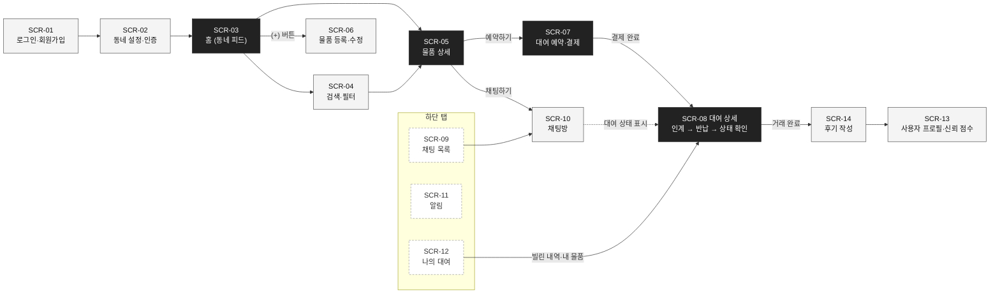
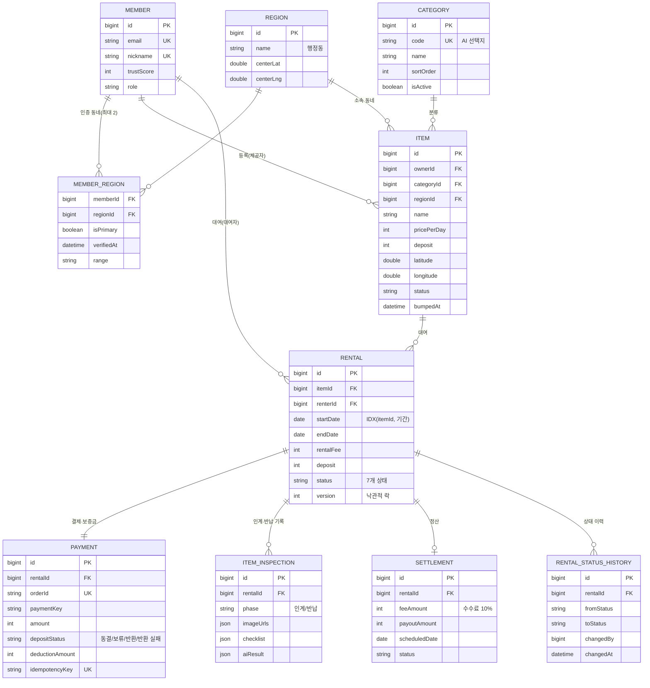
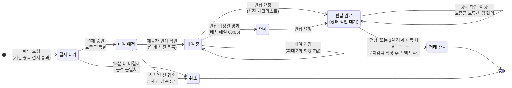
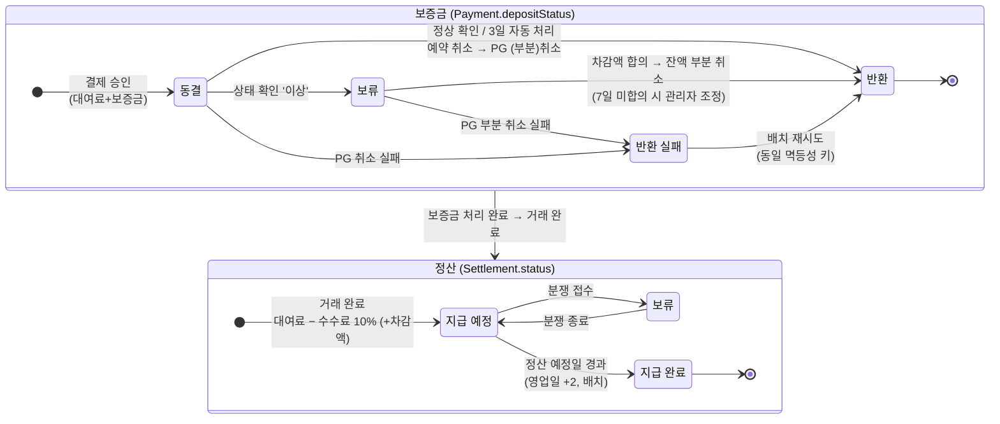
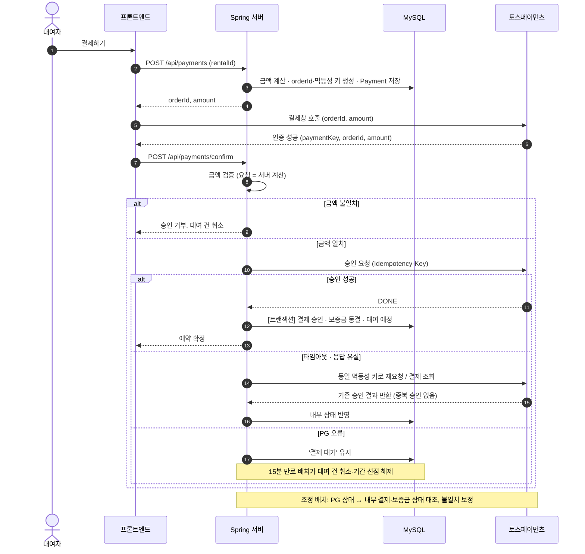
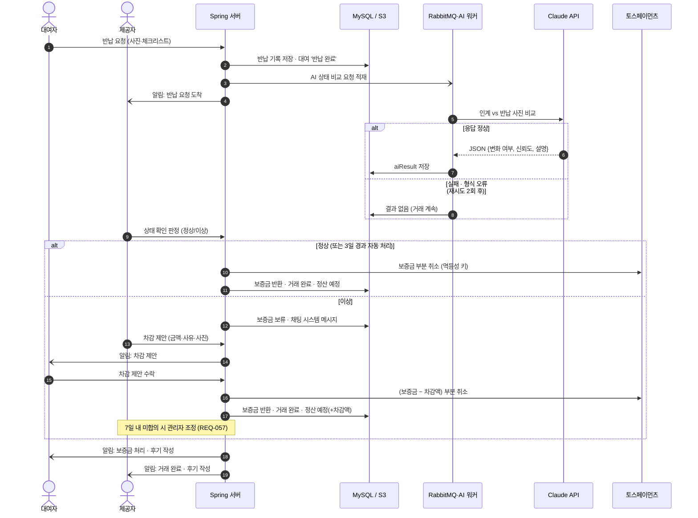
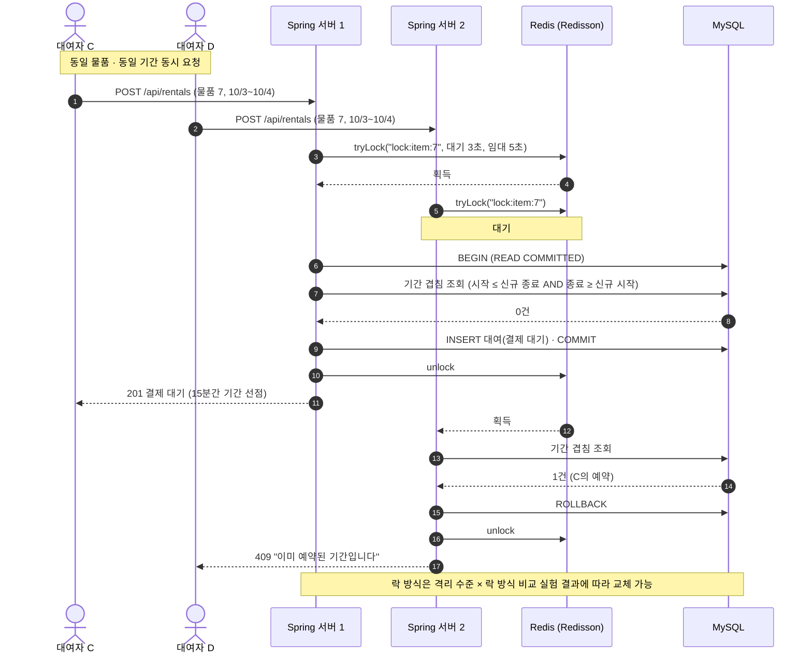

# 설계 다이어그램 Mermaid 원본

mermaid.live 또는 GitHub/Notion의 mermaid 코드 블록에 붙여 넣으면 그대로 렌더링됩니다.

## 0-1. 화면 흐름도

## 0-2. 핵심 ERD

## 1. 대여 상태 전이도

## 2. 보증금·정산 상태 전이도

## 3. 시퀀스: 결제 승인·실패 처리

## 4. 시퀀스: 반납 → 보증금 처리

## 5. 시퀀스: 예약 + 분산 락

