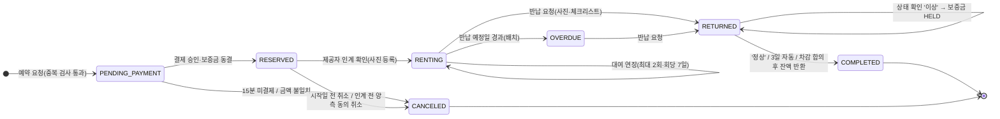
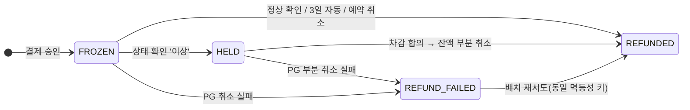

# 상태 머신과 Enum 코드

**규칙**: 상태 변경은 반드시 도메인 엔티티의 전이 메서드(예: `rental.handover(...)`)를 통해서만 한다. 서비스·컨트롤러에서 `setStatus()` 직접 호출 금지. 허용되지 않은 전이는 `409 RENTAL_INVALID_TRANSITION`. 모든 대여 상태 변경은 `rental_status_histories`에 (from, to, changedBy, reason, changedAt)을 기록한다. 시스템(배치)이 바꾼 경우 `changedBy = null`, reason에 배치명.

## 1. 대여 상태 `RentalStatus`

| 코드 | 한글(UI) | 의미 |
| --- | --- | --- |
| `PENDING_PAYMENT` | 결제 대기 | 예약 성공, 15분간 기간 선점 |
| `RESERVED` | 대여 예정 | 결제 완료, 인계 전 |
| `RENTING` | 대여 중 | 제공자가 인계 확인함 |
| `OVERDUE` | 연체 | 반납 예정일 경과 |
| `RETURNED` | 반납 완료(상태 확인 대기) | 대여자 반납 요청함. 보증금 보류 협의 중에도 이 상태 유지 |
| `COMPLETED` | 거래 완료 | 보증금 처리 끝 |
| `CANCELED` | 취소 | |

### 전이 표

| From | To | 트리거 | 주체 | 가드 조건 | REQ |
| --- | --- | --- | --- | --- | --- |
| — | PENDING_PAYMENT | 예약 요청 | 대여자 | 본인 물품 아님, 기간 유효, 겹침 없음, 대표 동네 인증 | 013 |
| PENDING_PAYMENT | RESERVED | 결제 승인 | 시스템 | 금액 일치 | 024 |
| PENDING_PAYMENT | CANCELED | 결제 만료 / 금액 불일치 | 시스템 | 생성 후 15분 경과 | 013, 024 |
| PENDING_PAYMENT | CANCELED | 사용자 취소 | 당사자 | | 015 |
| RESERVED | RENTING | 인계 확인 | 제공자 | 오늘 ≥ startDate, 사진 1~5장 | 017 |
| RESERVED | CANCELED | 취소 | 당사자 | 오늘 < startDate (환불), 또는 시작일 이후면 **양측 동의** | 015 |
| RENTING | RENTING | 연장 | 대여자 | 연장 횟수 < 2, 일수 ≤ 7, 이후 기간 비어 있음, 추가 결제 완료 | 038 |
| RENTING | OVERDUE | 연체 배치 | 시스템 | endDate < 오늘 | 023 |
| RENTING, OVERDUE | RETURNED | 반납 요청 | 대여자 (또는 제공자 대리 접수) | 사진 1~5장 + 체크리스트 | 018 |
| RETURNED | COMPLETED | 상태 확인 '정상' | 제공자 | 보증금 반환 성공(또는 1순위 단계) | 018, 025 |
| RETURNED | COMPLETED | 자동 정상 처리 | 시스템 | 반납 요청 후 3일, 상태 확인 없음 | 018 |
| RETURNED | RETURNED | 상태 확인 '이상' | 제공자 | 이상 내용·사진 필수 → depositStatus=HELD | 018, 049 |
| RETURNED | COMPLETED | 차감 합의 | 대여자 수락 | 잔액 부분 취소 성공 | 049 |

> **1순위 단계(payment-enabled=false)**: 예약 시 바로 `RESERVED` 생성, 취소는 상태만 변경, `RETURNED → COMPLETED`에서 보증금 처리 생략.

### UI 탭 매핑

| 화면 탭 | 포함 상태 |
| --- | --- |
| 빌린 내역 > 대여 예정 | PENDING_PAYMENT, RESERVED |
| 빌린 내역 > 대여 중 | RENTING, OVERDUE, RETURNED |
| 빌린 내역 > 완료 | COMPLETED, CANCELED |
| 캘린더 "예약됨" (=기간 점유) | PENDING_PAYMENT(15분 유효), RESERVED, RENTING, OVERDUE |
| 물품 삭제 불가 조건 | PENDING_PAYMENT, RESERVED, RENTING, OVERDUE, RETURNED |
| 내 물품 > 대여 중 탭 | 해당 물품에 RENTING 또는 OVERDUE 대여가 있음 |

**활성(기간 점유) 상태 집합** `ACTIVE_FOR_PERIOD = {PENDING_PAYMENT(만료 전), RESERVED, RENTING, OVERDUE}` — 중복 검사·캘린더·대여 가능 기간 수정 검사에서 공통으로 사용. 상수 하나로 정의할 것.

> 주의: OVERDUE는 endDate가 지나도 물품이 아직 대여자에게 있다. 연체 건 이후 예약이 있으면 실제로 물품을 줄 수 없게 되지만, 명세상 별도 처리 규칙은 없다 → `open-issues.md` 참고.

## 2. 보증금 상태 `DepositStatus` (Payment.depositStatus)

| 코드 | 한글 | |
| --- | --- | --- |
| `FROZEN` | 동결 | 결제 승인 직후 |
| `HELD` | 보류 | 상태 확인 '이상' |
| `REFUNDED` | 반환 | (부분)취소 성공. 차감 시 일부만 반환 |
| `REFUND_FAILED` | 반환 실패 | PG 취소 실패 → 배치 재시도, 반복 실패 시 관리자 확인 대상 |

## 3. 정산 상태 `SettlementStatus`

| 코드 | 한글 |
| --- | --- |
| `SCHEDULED` | 지급 예정 |
| `HELD` | 보류 (분쟁 진행 중) |
| `PAID` | 지급 완료 (실제 송금 없음) |

`[거래 완료] → SCHEDULED → (영업일+2 배치) → PAID`, `SCHEDULED ⇄ HELD` (분쟁 접수/종료).

## 4. 결제 상태 `PaymentStatus` (구현 제안)

명세에는 "결제 상태"만 있고 값이 정의되어 있지 않다. 다음을 제안한다.

| 코드 | 의미 |
| --- | --- |
| `READY` | 주문 생성(orderId 발급), 승인 전 |
| `APPROVED` | PG 승인 완료 |
| `CANCELED` | 전액 취소 |
| `PARTIAL_CANCELED` | 부분 취소(보증금 반환 등) |
| `FAILED` | 승인 실패·금액 불일치 |

## 5. 기타 Enum

| Enum | 값 |
| --- | --- |
| `ItemStatus` | `AVAILABLE`(대여 가능), `HIDDEN`(숨김), `DELETED`(삭제) — "대여 중"은 상태가 아니라 대여 건으로 파생 |
| `ItemCondition` | `LIKE_NEW`(새 상품급), `LIGHTLY_USED`(사용감 적음), `USED`(사용감 있음) |
| `RegionRange` | `NEAR`(1.5km), `NORMAL`(3km), `FAR`(6km) |
| `InspectionPhase` | `HANDOVER`(인계), `RETURN`(반납) |
| `InspectionResult` | `NORMAL`(정상), `ABNORMAL`(이상) |
| `DamageGrade` | `A`, `B`, `C`, `D` |
| `DeductionType` | `NONE`, `FIXED`(정액), `ACTUAL`(실비), `FULL`(전액) |
| `CancelReason` | `SCHEDULE_CHANGE`(일정 변경), `ITEM_PROBLEM`(물품 문제), `COUNTERPART_REQUEST`(상대방 요청), `OTHER`(기타, 사유 텍스트 필수) |
| `Satisfaction` | `BAD`(별로예요), `GOOD`(좋아요), `BEST`(최고예요) |
| `ComplimentType` | `ON_TIME`(시간 약속), `AS_DESCRIBED`(물품 상태가 설명과 같음), `CLEAN_USE`(깨끗하게 사용) … 확장 가능 |
| `MemberStatus` | `ACTIVE`, `SUSPENDED`, `WITHDRAWN` |
| `MemberRole` | `USER`, `ADMIN` |
| `AuthProvider` | `LOCAL`, `KAKAO` |
| `ChatMessageType` | `TEXT`, `IMAGE`, `APPOINTMENT`, `SYSTEM` |
| `ReportStatus` | `PENDING`, `DISMISSED`, `WARNED`, `SUSPENDED` |
| `CategorySuggestionStatus` | `PENDING`, `APPROVED`, `REJECTED` |
| `ReturnChecklistItem` | `NO_EXTERIOR_DAMAGE`(외관 파손 없음), `ALL_PARTS_INCLUDED`(구성품 전부), `NO_CONTAMINATION`(오염 없음), `WORKS_NORMALLY`(정상 작동), `CONSUMABLES_RESTORED`(충전·소모품 원상 복구) |

### NotificationType

`RESERVATION_CONFIRMED`, `PAYMENT_COMPLETED`, `RESERVATION_CANCELED`, `HANDOVER_CONFIRMED`, `HANDOVER_REMINDER`, `RETURN_REQUESTED`, `INSPECTION_RESULT`, `DEPOSIT_REFUNDED`, `DEPOSIT_HELD`, `DEDUCTION_PROPOSED`, `OVERDUE`, `RENTAL_EXTENDED`, `REVIEW_RECEIVED`, `AI_COMPARE_DONE`, `KEYWORD_MATCHED`(3순위), `APPOINTMENT_REMINDER`(3순위)
